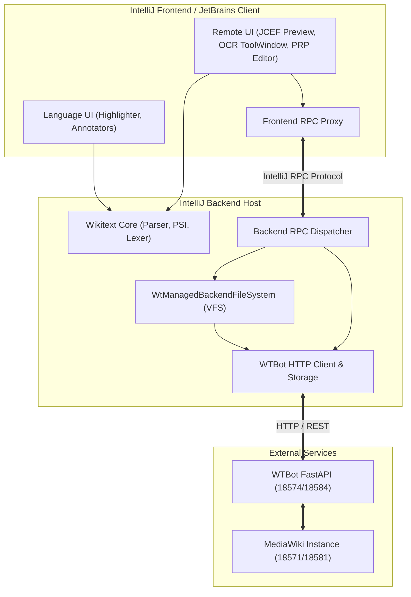

# Requirements

### Overview & Goals
The objective is to restructure the project into two distinct, independently buildable and maintainable IntelliJ plugins, aligning with JetBrains' split-mode (backend / frontend / shared) plugin architecture:
1. **Wikitext Language Support Plugin** (`org.limepepper.lang.wikitext`): A focused, robust, and self-contained language engine providing file type recognition (`.wt`, `.wiki`, `.prp`), lexer/parser/PSI tree, syntax highlighting, annotators, live templates, code formatting, and structure views. It has zero external dependencies on network services, remote filesystems, or JCEF.
2. **Wikisource Remote Editing Plugin** (`org.limepepper.wikisource`): A rich remote editing and collaboration extension that depends on the Wikitext Language Support plugin. It provides the custom `wikisource-wtbot://` VFS, MediaWiki / WTBot backend integration, JCEF-based rendering and scan image previews, OCR review workflows, ProofreadPage custom editors, and split-mode client-server communication.

To minimize operational disruption and deliver immediate utility, the reorganization is structured as a **Two-Phase Extraction**:
- **Phase 1 (Binary Plugin Split)**: Disentangle language features from remote VFS/API services and establish two standalone plugin distributions.
- **Phase 2 (Split-Mode Refactoring)**: Modularize the remote plugin into backend, frontend, and shared RPC components compliant with IntelliJ split-mode.

---

### Scope
#### In Scope
- **Core Decoupling**: Separating local Wikitext language features (`wikitext-core`, annotators, surround descriptors, syntax highlighters) from remote VFS/API services.
- **Gradle Multi-Plugin Architecture**: Configuring separate plugin assemblies (`wikitext-language-plugin` and `wikisource-remote-plugin`) in `build.gradle.kts` and `settings.gradle.kts`.
- **Plugin Descriptors**: Authoring clean `plugin.xml` and content module descriptors with explicit plugin dependencies (`wikisource-remote` requires `wikitext-language`).
- **Split-Mode Modularization (Remote)**: Subdividing the remote editing plugin into `wikisource-remote-shared`, `wikisource-remote-backend`, and `wikisource-remote-frontend`.
- **RPC Contracts**: Defining typed remote procedure call (RPC) interfaces for page browsing, file loading/saving, scan metadata retrieval, and OCR interactions.
- **Test Suite Alignment**: Ensuring unit and integration tests validate both standalone language operations and full remote workflows.

#### Out of Scope
- Major syntax additions or parser grammar redesign for Wikitext.
- Upstream MediaWiki API changes or rewriting the WTBot Python sidecar service.
- Re-enabling commented-out prototypes (such as `ProofreadInlayProvider`) during the refactor.

---

### User Stories
- **As a Wikitext author**, I want to install a lightweight, fast Wikitext plugin for local `.wt` / `.wiki` editing without unwanted network configurations, JCEF overhead, or remote daemon dependencies.
- **As a Wikisource contributor**, I want to install the Wikisource Remote Editing extension to connect to MediaWiki instances, edit pages via WTBot, preview scans in JCEF, and run OCR directly within my IDE.
- **As a remote development user (IntelliJ Split Mode / JetBrains Client)**, I want the remote editing plugin to operate seamlessly across backend and frontend processes, keeping heavy VFS/daemon tasks on the host and responsive UI on the client.
- **As a plugin maintainer**, I want clear component boundaries and independent test suites so that stable language parsing remains unaffected by rapid remote editing feature iterations.

---

### Functional Requirements
- **FR-1: Standalone Language Editing**: Opening `.wt` or `.wiki` files provides full syntax highlighting, folding, PSI inspection, sentence band annotation, and surround-with actions without starting any network background threads or requiring JCEF.
- **FR-2: ProofreadPage Local Fallback**: When the Remote plugin is absent, `.prp` files are handled as standard Wikitext files by the Language plugin rather than producing errors.
- **FR-3: Remote Plugin Dependency**: Installing `org.limepepper.wikisource` automatically requires and consumes `org.limepepper.lang.wikitext`.
- **FR-4: Split-Mode VFS Operations**: In split mode, the VFS (`wikisource-wtbot://`) and WTBot HTTP client run authoritatively on the backend, while file editor tabs, toolbar actions, and tool windows render on the frontend.
- **FR-5: Tool Window & Setting Separation**: Wikitext highlighting settings appear under Editor settings, while WTBot backend configurations and OCR tool windows appear only when the Remote plugin is active.

---

### Non-Functional Requirements
- **Performance**: Zero startup delay or memory overhead from JCEF/VFS when only language support is utilized.
- **Binary Hygiene**: No duplicated class files or duplicate extension point registrations between distribution archives.
- **Verification**: Zero warnings or errors in IntelliJ Plugin Verifier for both plugin distributions on targeted IDE builds (pin 2026.2.4+).

# Technical Design

### Current Implementation
The repository currently builds a single monolithic plugin (`org.limepepper.lang.wikitext`) containing three internal modules:
- `wikitext-core`: Grammar-Kit parser (`Wikitext.bnf`), JFlex lexer (`WikitextLexer.flex`), PSI elements, file types (`WtFileType`, `PrpFileType`), and quote/wrap editing utilities.
- `wikitext-ui`: Mixed module containing language annotators, syntax highlighting, live templates, as well as remote features: JCEF scan preview browsers, PRP text editors, OCR tool windows, and image annotation canvases.
- `wikitext-vfs`: Managed backend virtual file system (`WtManagedBackendFileSystem`), WTBot HTTP clients, indexing services, and settings configurables.

The root `build.gradle.kts` bundles all three modules unconditionally into one distribution archive with JCEF platform modules required at the root descriptor level.

---

### Key Decisions
1. **Two-Phase Extraction Strategy**:
   - *Approach*: First disentangle language vs remote responsibilities into two distinct distribution plugins (`wikitext-language-plugin` and `wikisource-remote-plugin`). In Phase 2, split `wikisource-remote` into `shared`, `backend`, and `frontend` submodules.
   - *Rationale*: Delivers maximum utility by immediately stabilizing the core language engine and verifying packaging before introducing the architectural complexity of split-mode RPC.
2. **Fresh Plugin ID Assignment**:
   - *Approach*: Assign `org.limepepper.lang.wikitext` to the standalone Language Support Plugin and `org.limepepper.wikisource` to the Remote Editing Plugin.
   - *Rationale*: Eliminates historical baggage, establishes intuitive naming, and reflects the true dependency hierarchy (`wikisource` depends on `wikitext`).
3. **RPC Boundary Placement**:
   - *Approach*: Host `WtManagedBackendFileSystem` and WTBot communication strictly on the IDE backend; frontend components communicate via typed RPC services (`WtRemotePageRpcService`, `OcrRpcService`).
   - *Rationale*: IntelliJ split mode mandates that heavy I/O, persistence, and VFS implementations reside on the backend host, keeping the frontend lightweight.

---

### Proposed Module Architecture
```
wikisource/
├── wikitext-core/                     (Shared language definitions: Lexer, Parser, PSI, FileTypes)
├── wikitext-language-ui/              (Language UI: Syntax highlighter, annotators, templates, actions)
├── wikitext-language-plugin/          (Distribution assembly for Wikitext Language Support)
│
├── wikisource-remote-shared/          (Split-mode RPC contracts, DTOs, identifiers)
├── wikisource-remote-backend/         (VFS backend, WTBot HTTP client, indexing, settings storage)
├── wikisource-remote-frontend/        (JCEF browsers, OCR tool window, PRP editor UI, client configurables)
└── wikisource-remote-plugin/          (Distribution assembly for Wikisource Remote Editing)
```

---

### Data Models / Contracts (RPC Services)

```kotlin
// In module: wikisource-remote-shared
package org.limepepper.wikisource.remote.rpc

import kotlinx.serialization.Serializable

@Serializable
data class PageIdentifier(
    val wikiId: String,
    val title: String,
    val revisionId: Long? = null
)

@Serializable
data class PageSnapshot(
    val id: PageIdentifier,
    val content: String,
    val quality: Int? = null,
    val scanImageUrl: String? = null
)

@Serializable
data class OcrRequest(
    val pageId: PageIdentifier,
    val engine: String,
    val boundingBox: List<Double>? = null
)

@Serializable
data class OcrResponse(
    val pageId: PageIdentifier,
    val recognizedText: String,
    val confidence: Double
)

@Remote
interface WtRemotePageRpcService {
    suspend fun fetchPage(id: PageIdentifier): PageSnapshot
    suspend fun savePage(id: PageIdentifier, content: String, summary: String): Boolean
    suspend fun runOcr(request: OcrRequest): OcrResponse
}
```

---

### Architecture Diagram



---

### Risks & Mitigations
- **Risk: Document synchronization divergence between Frontend Editor and Backend VFS.**
  - *Mitigation*: Leverage IntelliJ Platform's built-in `FileDocumentManager` and document synchronization primitives across the split-mode RPC boundary rather than rolling custom raw socket transports.
- **Risk: JCEF unavailable in headless or remote thin-client environments.**
  - *Mitigation*: Isolate JCEF dependencies strictly to `wikisource-remote-frontend` and provide graceful fallback panes if JCEF initialization fails.
- **Risk: Class duplication in nested plugin archives.**
  - *Mitigation*: Configure Gradle dependency scopes such that `wikisource-remote-plugin` references `wikitext-language-plugin` as an external plugin dependency (`compileOnly` / plugin dependency) without bundling language JARs inside the remote archive.

# Testing

### Validation Approach
Verification follows a tiered testing strategy ensuring both local language features and remote split-mode capabilities remain rock-solid throughout the migration:
1. **Unit & Lexer/Parser Tests**: Fast JVM unit tests validating grammar rules, token generation, quote wrapping, and sentence band logic.
2. **Plugin Packaging & Verifier Validation**: Running IntelliJ Plugin Verifier against both output archives (`wikitext-language-plugin.zip` and `wikisource-remote-plugin.zip`).
3. **IDE Starter Integration Tests**: Automated UI and functional tests in headless and visible modes validating startup, file opening, VFS navigation, and tool window visibility.

---

### Key Scenarios
- **Scenario 1: Language-Only Standalone Installation**:
  - Install only `wikitext-language-plugin`.
  - Open `.wt` and `.wiki` files: verify highlighting, PSI tree, structure view, and quote toggles work properly.
  - Verify no WTBot background connections or OCR tool windows are registered.
- **Scenario 2: Dual Plugin Installation**:
  - Install both `wikitext-language-plugin` and `wikisource-remote-plugin`.
  - Verify `wikisource-wtbot://` VFS mounts correctly, remote tree browser populates from WTBot backend, and PRP editor opens with scan images and OCR review tools.
- **Scenario 3: Split-Mode Client-Server Operation**:
  - Launch backend IDE host and JetBrains Client frontend.
  - Trigger page edits, scan previews, and OCR actions from the frontend; verify RPC calls correctly dispatch to the backend VFS and persist to the WTBot backend.

---

### Edge Cases
- **Missing Remote Plugin with `.prp` File**: Opening a `.prp` file in Language-only mode gracefully renders as standard Wikitext in the default editor without throwing unresolved class exceptions.
- **Backend Disconnection during Split Mode**: If the WTBot service is unreachable, the frontend displays non-blocking notifications and preserves local in-memory edits.
- **Plugin Uninstallation & Disabling**: Disabling `wikisource-remote-plugin` cleanly tears down tool windows and VFS listeners without corrupting IDE editor state or affecting `wikitext-language-plugin`.

---

### Test Suite Adaptations
- `wikitext-core/src/test/**`: Runs exclusively against `wikitext-core` with no VFS or platform UI fixtures.
- `wikitext-language-ui/src/test/**`: Runs annotator and highlighting tests with light platform fixtures.
- `wikisource-remote-backend/src/test/**`: Runs VFS and fake HTTP backend test suites (`FakeVfsBackendTest`, `WtPathsTest`).
- `src/integrationTest/**`: Extended Starter scenarios (`PluginStartupTest`) parameterize to test both standalone Language and dual Remote plugin installations.

# Delivery Steps

### ✓ Step 1: Disentangle language features and isolate module dependencies
Language-only features have zero dependencies on VFS, HTTP/WTBot backend, or JCEF UI classes.

- Move generic editing actions, syntax highlighting, annotators (`WtSentenceBandAnnotator`, `WtReferenceAnnotator`), surround descriptors, and live templates out of `wikitext-ui` into a dedicated language UI module or package.
- Move remote-specific UI components (JCEF preview browser `WtRenderPreviewBrowser`, OCR tool window `OcrToolWindowFactory`, Proofread Page editor `PrpFileEditor`, and image annotation panes) into a dedicated remote UI module.
- Split UI resource bundles and registry keys so that language strings and remote strings reside in separate message bundles without cross-module bleeding.
- Ensure all existing unit tests in `wikitext-core` and language UI pass independently without loading VFS or remote services.

### ✓ Step 2: Establish dual plugin distributions and Gradle packaging
The project produces two distinct, independently buildable plugin distributions with clear dependency relationships.

- Configure `wikitext-language-plugin` with ID `org.limepepper.lang.wikitext` containing `wikitext-core` and language UI components.
- Configure `wikisource-remote-plugin` with ID `org.limepepper.wikisource` containing `wikitext-vfs` and remote UI components, declaring a required plugin dependency on `org.limepepper.lang.wikitext`.
- Update `settings.gradle.kts` and root `build.gradle.kts` to define the separate plugin assemblies using `org.jetbrains.intellij.platform` and `org.jetbrains.intellij.platform.module`.
- Verify standalone language plugin packaging and verify that the remote plugin resolves language dependencies via Gradle and Plugin Verifier.

### ✓ Step 3: Decompose remote editing into split-mode backend and frontend modules
The remote editing plugin is decomposed into shared, backend, and frontend content modules with explicit process markers.

- Create `wikisource-remote-shared` containing serializable DTOs, page identifiers, remote view models, and RPC service interfaces.
- Create `wikisource-remote-backend` containing VFS implementations (`WtManagedBackendFileSystem`), WTBot HTTP clients, index cache services, and background synchronization tasks.
- Create `wikisource-remote-frontend` containing JCEF scan/render previews, OCR review tool windows, PRP editor extensions, and settings configurables.
- Annotate module descriptors with `required-if-available="intellij.platform.backend"` and `required-if-available="intellij.platform.frontend"` process markers.

### ✓ Step 4: Implement RPC interfaces and split-mode integration tests
Remote editor operations operate seamlessly across IntelliJ split-mode process boundaries via RPC contracts.

- Implement backend RPC endpoints for page browsing, document content retrieval, save execution, and OCR triggering.
- Wire frontend UI actions (browser tree selection, OCR review, render previews) to backend RPC services rather than direct VFS/HTTP singleton calls.
- Update `src/integrationTest` Starter test suites to validate both standalone language editing and remote Wikisource split-mode workflows.
- Run Plugin Verifier against both plugin distributions to guarantee zero deprecated or forbidden API usages.