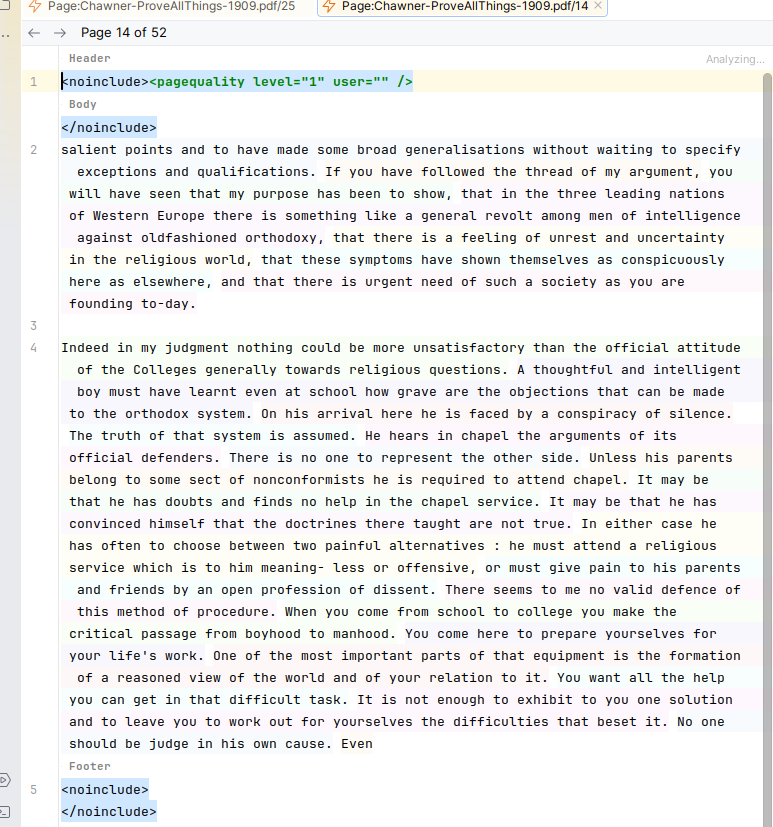

# ProofreadPage editors

Pages opened from the [Wikisource browser](browser.md) open in an editor chosen
by their MediaWiki content model:

| Content model | Editor |
|---|---|
| `proofread-page` (`Page:` namespace) | **Proofread page editor**: the page text beside its reference scan and a rendered preview. |
| `proofread-index` (`Index:` namespace) | Index editor: the Index text beside a rendered preview. |
| anything else (`wikitext`, local `.wt` files) | Wikitext editor: the text beside a rendered preview. |
| `json`, `sanitized-css` | The IDE's normal JSON / CSS editor. |

All of them are split editors. The buttons in the editor's top-right corner
switch between editor only, editor and preview, and preview only.

Saving (`Ctrl+S`, or the IDE's autosave) stores the text in wtbot's local edit
journal; it does not publish to the wiki. If the page changed in wtbot since you
opened it, the save is refused and your text is kept; reload the file to see
the newer version.

## Rendered preview

The preview shows the wiki's own rendering of your **unsaved** text, including
templates, the ProofreadPage quality banner and the wiki's stylesheets. It is
rendered by the wiki through wtbot, about half a second after you stop typing.
**Reload Preview** on the preview toolbar renders again immediately; the
proofread editor's preview toolbar also has zoom in, zoom out and reset zoom.
In the proofread editor, right-clicking the preview offers **Open in Browser**,
which opens the page in your system browser.

Where the IDE has no embedded browser (JCEF), the preview falls back to a basic
HTML view.

## The proofread page editor



### Text

The text pane shows the page exactly as stored:

```
<noinclude><pagequality level="1" user="" />header</noinclude>body<noinclude>footer</noinclude>
```

The `<noinclude>` and `<pagequality>` tags are protected so they cannot be
deleted by accident; the running header and footer text between them is
editable. **Header**, **Body** and **Footer** labels mark the three sections,
and each section starts on its own visual line without inserting real line
breaks. A page that is empty or not in this shape is left fully editable.

**Select All** (`Ctrl+A`) first selects only the body, so select-and-paste
replaces the transcription without touching the framing; pressing it again
selects everything.

The toolbar above the text shows **Page N of M** and has **Previous Page** and
**Next Page** buttons that open the neighbouring pages of the same Index.

The page's quality level is set from the browser's context menu
(**Set Page Quality…**, **Mark Ready to Validate**).

### Reference scan and preview

The right-hand side holds two previews — the page's **reference scan** and the
**rendered preview** — and its toolbar chooses which you see:

- **Reference Image**, **Rendered Preview** or **Compare Both**;
- when comparing, **Tile Side by Side** or **Tile Stacked**, and **Swap Panes**.

The scan comes from wtbot. If the wiki's scan cannot be found, a placeholder
labelled with the page title is shown instead.

Scan controls: wheel scrolls, `Shift`+wheel scrolls horizontally,
`Ctrl`+wheel zooms, middle-drag pans. The scan toolbar has **Zoom In**,
**Zoom Out**, **Reset Zoom** (fit width or whole page, see below) and
**Show Bounding Boxes**. Its **Send to OCR** button is a placeholder and does
nothing yet; OCR is run from a box's context menu (see [OCR](ocr.md)).

### Bounding boxes

Boxes drawn on the scan mark regions of interest — a paragraph, a table, a
formula — and are saved to wtbot with the page.

- Left-drag on empty scan draws a box; click selects; drag moves; drag a
  handle resizes. `Delete` removes the selected box; `Escape` cancels a drag.
- Right-click a box for **Run OCR**, **Send to Text Range**,
  **Go to Linked Range**, **Category** and **Delete Box**.

### Text ranges

A text range marks a span (or an insertion point) of the transcription body,
for example where the text recognised from a box belongs.

- Select text (or place the caret) and choose **Save Text Range**
  (`Alt+Shift+T`, also on the editor's right-click menu).
- Ranges are drawn as outlined boxes; the one containing the caret is
  emphasised. Drag the small handles to adjust an edge. The gutter icon's menu
  deletes a range, resets it to the current selection or collapses it to an
  insertion point.
- Ranges follow your edits and are saved to wtbot.

A box is linked to a range either from its **Send to Text Range** menu or by
dragging the box's link handle onto the range in the editor. A linked range
takes its box's category colour, and OCR text for that box can be applied
straight into it.

### Structure view

The Structure tool window follows the active pane: the wikitext structure when
the text has focus, the list of bounding boxes (in reading order) when the scan
is active.

### Preview defaults

These registry keys (**Help → Find Action → Registry…**) set how the preview
side opens. A toolbar change lasts only for that editor.

| Key | Default | Values |
|---|---|---|
| `wikitext.editing.preview.mode` | `both` | `both`, `image` (scan only), `render` (preview only) |
| `wikitext.editing.preview.splitStacked` | `true` | stack scan above render when showing both |
| `wikitext.editing.preview.imageFitMode` | `width` | `width` or `page` (whole page) for the scan's initial zoom |

## Local `.prp` files

A local file with the `.prp` extension opens in the proofread page editor too.
Without wtbot there is no scan or rendered preview, and boxes are kept in
memory only.
